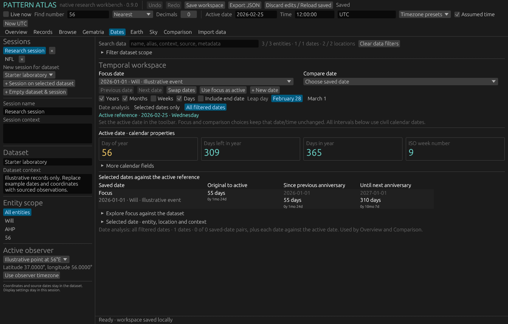
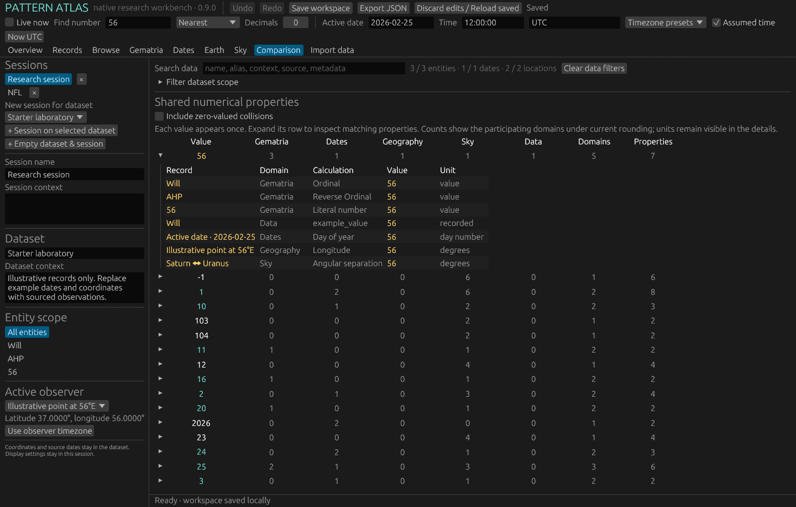

# Pattern Atlas

A native Rust workbench for connected datasets and numerical pattern exploration. Link entities, aliases, dates and locations, then explore gematria, calendar relationships, geography and sky positions through a shared number search. The interface uses egui/eframe, with SQLite persistence and a reusable Rust calculation core. No browser is needed.

Current version: **0.9.0**, developed and tested on Windows. This is an evolving personal research tool; feedback on the interface, architecture, data model and calculation correctness is welcome. See [CONTRIBUTING.md](CONTRIBUTING.md) for specific review questions and build instructions.





The screenshots use synthetic demonstration records. Saved workspaces, databases, binaries and local QA data are excluded from this repository. Source JSON examples and the sourced NFL dataset are included. See [THIRD_PARTY.md](THIRD_PARTY.md) and [NFL sources](datasets/NFL-SOURCES.md) for provenance.

## Run on Windows

Build from source first using the commands below, then open `dist\pattern-atlas.exe`, or run this from PowerShell in your checkout:

```powershell
.\dist\pattern-atlas.exe --data-dir .\data
```

No browser, Rust installation or WSL is required to run the compiled Windows executable. Keep the portable executable in a writable directory. Double-clicking uses a `data` directory beside the executable; the command above uses the project data directory. The first launch creates illustrative examples only when the database is empty.

## Build and develop

Install stable Rust for Windows using the MSVC toolchain, with rustfmt and clippy, and Visual Studio Build Tools with the **Desktop development with C++** workload. Run these commands from the repository root:

```powershell
cargo fmt --all -- --check
cargo test --workspace --locked
cargo clippy --workspace --all-targets --locked -- -D warnings
cargo run -p pattern-atlas --locked -- --data-dir .\data
```

For a packaged optimized executable, use the build script:

```powershell
powershell -NoProfile -ExecutionPolicy Bypass -File .\scripts\build.ps1
```

The script runs format/checks/tests, builds release and copies the executable to `dist`. It keeps Cargo caches and temporary files in a `.build-cache` directory beside your checkout and uses a cached Rust toolchain there if one is present; otherwise it uses your installed toolchain. It does not change permanent environment variables. To develop:

```powershell
powershell -NoProfile -ExecutionPolicy Bypass -File .\scripts\run.ps1
```

The process-scoped execution policy above lets these local project scripts run without changing your system policy. You can also inspect the scripts and execute their Cargo commands yourself.

## First build

- Separate dataset records and research-session settings; reusable entities, aliases, tags, context and source notes.
- Labeled observations linked to an entity and optionally a place; date-only precision is preserved.
- Native editor, multiple datasets/sessions, explicit save, save on close, optimistic revision checks and 50 saved SQLite revisions.
- JSON workspace export/import and CLI analysis through the same engine.
- 13 starting cipher tables, toggleable with letter contributions on hover. Currently ASCII English only.
- Civil calendar spans with independent years/months/weeks/days controls, end inclusion, leap-day policy, days from event, days to next anniversary and pairwise dates.
- Coordinate plot, active observer, latitude/longitude deltas, shortest longitude separation, central angle and spherical distance in km/mi/m/ft.
- Shared number search and a domain comparison matrix. Raw, nearest (half away from zero), and floor transformations with decimal precision; raw values remain inspectable.

## Editing and recovery (0.2)

Use **Remove** beside an alias or tag, **×** beside a session, **Remove date**, **Remove entity & dates**, or **Remove place** in its expanded editor. Removing an entity removes its own labeled dates and clears session selections for that entity. Removing a place clears its links while keeping dates. Removing a session retains its dataset. The dataset picker under Sessions lets you start a new session for retained datasets. At least one session stays in the workspace; create another before removing the final one.

**Undo / Ctrl+Z** and **Redo / Ctrl+Y or Ctrl+Shift+Z** work across the workspace, including edits, removals, creation, settings and loaded JSON imports. Consecutive typing in one field is grouped; a pause or another field starts a new step. There are up to 100 undo steps during the current app run. Saving does not clear undo. Undoing back to the saved state clears the unsaved marker; otherwise save the recovered state to commit it. Invalid date/time drafts can also be undone. Panel/entity navigation does not add undo steps. Pasted JSON in the import scratch field uses ordinary text undo until it is loaded into the workspace.

For recovery after restarting, expand **Saved history · recover earlier work** on Overview. It lists the last 50 saved workspace revisions with UTC timestamps. **Restore in memory** lets you inspect a revision; **Save workspace** commits the recovery as a new revision. Undo can return to your edits before restoration. Saved revisions and the database's optimistic conflict protection remain active.

The build script also creates `dist\pattern-atlas-0.2.0.exe`. If the current app is running, Windows may prevent replacing `dist\pattern-atlas.exe`; the versioned file is still available. Save and close the current window, then run the updated executable with the same data directory you used before. Double-clicking either file uses the same adjacent `dist\data` directory.

Version 0.3 adds offline Earth/sky views and saved-date creation/linking. Read [GUIDE-0.3.md](GUIDE-0.3.md) for the current workflow, sky conventions, supported range and remaining extensions.

Version 0.4 fixes date-workspace repaint and location rename focus, adds city/state coordinate and timezone lookup, Central-time presets, and reviewed bulk additions with a copyable AI prompt and word-list converter. Start with [GUIDE-0.4.md](GUIDE-0.4.md). The new executable is `dist\pattern-atlas-0.4.0.exe`. Schema-1/2 data upgrades to schema 3; use this version consistently once saved.

Version 0.5 adds a gematria matrix (one term per row, enabled ciphers as columns), map removal/context menus and fit-to-locations, shared session search/facets, a virtualized Browse panel, bounded pair comparisons, and an NFL dataset/session launcher. Use `dist\pattern-atlas-0.5.0.exe` or `Open NFL.cmd`; read [GUIDE-0.5.md](GUIDE-0.5.md). Schema 4 adds entity home/default-location links and saved session filters.

## Data

The canonical file is `data\atlas.sqlite` (the chosen data directory appears in the status bar after saving). SQLite stores schema-versioned workspace JSON plus saved revisions in transactions. Dataset entity/observation/place references use UUIDs. Sessions save their number query, ciphers, display settings, active observer/time and entity selection. Session context and dataset context are distinct. Export is a full portable workspace; importing replaces the workspace rather than merging.

Date-only records never acquire a source time automatically. Using one as the active date assumes local noon in its linked location timezone when available, otherwise its recorded timezone, and marks the session time as assumed. Change the active timezone explicitly or use the observer's timezone button. Existing source records stay unchanged. Ambiguous and nonexistent DST times are rejected; use an explicit UTC time to resolve them. Calendar durations use civil dates, not elapsed UTC seconds. Anniversaries do not precede the original event, and an anniversary today is zero days away.

Months use calendar arithmetic with month-end clamping. Independent unit toggles decompose the span in enabled units; residual days are shown even when the day toggle is off, so the displayed duration does not conceal a remainder. Signed days from event excludes end-date adjustment; absolute span totals include it when enabled. A future event shows negative signed elapsed days and positive time until the original event/anniversary.

Geography uses the haversine formula on a sphere of radius 6371.0088 km, not an ellipsoidal survey or route distance. Latitude and longitude are signed decimal degrees. B−A coordinate deltas follow selected A/B order in focused mode and dataset point order in all-filtered mode; shortest longitude separation wraps at ±180°. Display rounding is applied after unit conversion. A numeric match across units is a shared numeric representation, not equality of physical quantities.

SQLite prevents partial saves. If another process saves first, stale edits are rejected: export your edits before reopening. Export creates a new uniquely named file. CLI output also refuses to overwrite an existing file. Do not edit the live database externally; use exports. The initial UI is intended for small research datasets; preview tables are explicitly capped, and the feature export includes all results. Scalable indexing and background calculations follow in a later pass.

## CLI access

Version 0.9 combines Comparison into one list with expandable property details and adds active-date calendar tiles to Dates. Day of year, days left in year, year length, ISO week and further calendar fields participate in global number search and cross-domain matches. Use `dist\pattern-atlas-0.9.0.exe`; see [the 0.9 guide](GUIDE-0.9.md). Workspace schema remains 7. Date numerology is deferred.

Gematria now has a live phrase/number input, enabled-cipher totals, same-/cross-cipher matching and a separate cross-domain results table. Inputs can be saved as `gematria` entities with an inline editable type. Saved numeric terms are literal values instead of zero letter scores. Search and domain settings are per session; result tables scroll through all matching rows. See [the 0.8 guide](GUIDE-0.8.md).

The Dates panel separates a saved focus date, a saved comparison date and the active reference. Compact rows show original spans and previous/next anniversaries; three cards compare original and anniversary gaps between the selected dates. A searchable, scrolling relationship browser explores the focus against every filtered saved date. Date analysis can use selected or all filtered dates. See [the 0.7 guide](GUIDE-0.7.md).

The Earth panel has saved A/B dropdowns, individual detail cards, compact pair comparisons and a great-circle connecting line on both map and globe. **Selected A/B only** restricts global location analysis to enabled selections; **All filtered locations** explores the broader set. Existing sessions preserve the broader mode during upgrade. Overview reports the scope and shows number hits. See [the 0.6 guide](GUIDE-0.6.md) for selection, filters, sky observer behavior and undo.

Use the same executable and data directory:

```powershell
.\dist\pattern-atlas.exe --data-dir .\data --export .\workspace.json
.\dist\pattern-atlas.exe --data-dir .\data --analyze .\features.json
.\dist\pattern-atlas.exe --data-dir .\imported-data --import .\workspace.json
```

Analysis uses the first saved session and exports feature provenance, units and raw values. `--import` validates and commits a full workspace replacement; use a new data directory to keep separate workspaces. A programmatic integration can depend directly on `atlas-core`, with no GUI or SQLite dependency.

## Project map

- `crates/core`: model, ciphers, dates, geography and shared feature/match engine.
- `crates/storage`: SQLite save/load and conflict detection.
- `crates/desktop`: native interface and CLI adapter.
- `PLAN.md`: requested feature inventory, conventions, architecture and next passes.

WSL is optional for a separate Linux build. Windows and Linux executables are different builds; a `.sh` launcher alone does not make the Windows program native to Linux.
